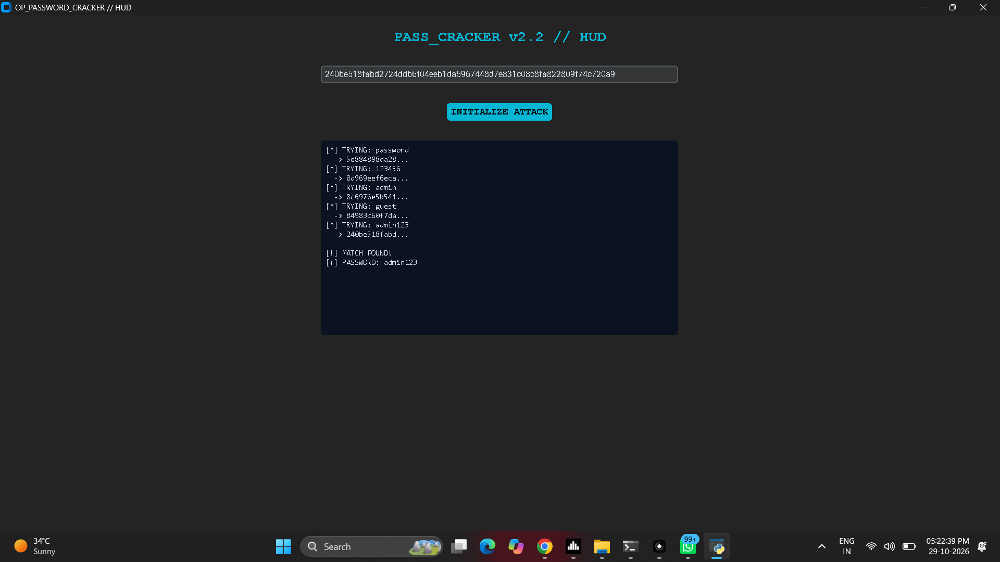

# 🔐 Password Cracker Project 🔓

<p align="center">
  
  
  
</p>

---

## 📖 Project Overview
This project is a **high-performance password cracking engine** designed for cybersecurity students. It demonstrates the mechanics of **dictionary attacks**, **cryptographic hashing**, and **parallel processing** using a custom Cyber-HUD graphical interface.

---

## 📸 Sample Output
*This is the live dashboard showing the cracking engine in action:*



---

## ⚙️ Step-by-Step Instructions

### 1. Setup Your Environment
Ensure you have Python installed. Then, open your terminal in this folder and install the required "HUD" libraries:
```bash
pip install colorama customtkinter
```

### 2. How to run the HUD GUI
The dashboard is the easiest way to interact with the engine.
```bash
python gui_cracker.py
```

### 3. Usage Guide (7th Class Style!)
1. **Launch:** Run the command above. The dashboard will open.
2. **The Target:** You will see a long string of numbers and letters in the top box. This is the **SHA-256 Hash**.
3. **Initialize Attack:** Click the big **"INITIALIZE ATTACK"** button.
4. **Detective Work:** Watch the window in the middle! It shows you every password it is trying to "guess" (test) in real-time.
5. **Victory:** Once it finds the match, it will stop and display: 
   > **[!] MATCH FOUND!**
   > **[+] PASSWORD: admin123**

---

## 🛡️ Defensive Engineering Note
In the real world, hackers use tools like this to test systems. To protect accounts, security engineers use:
- **Salting:** Random strings added to passwords.
- **Key Stretching:** Using algorithms like *bcrypt* to make password testing thousands of times slower.

---

